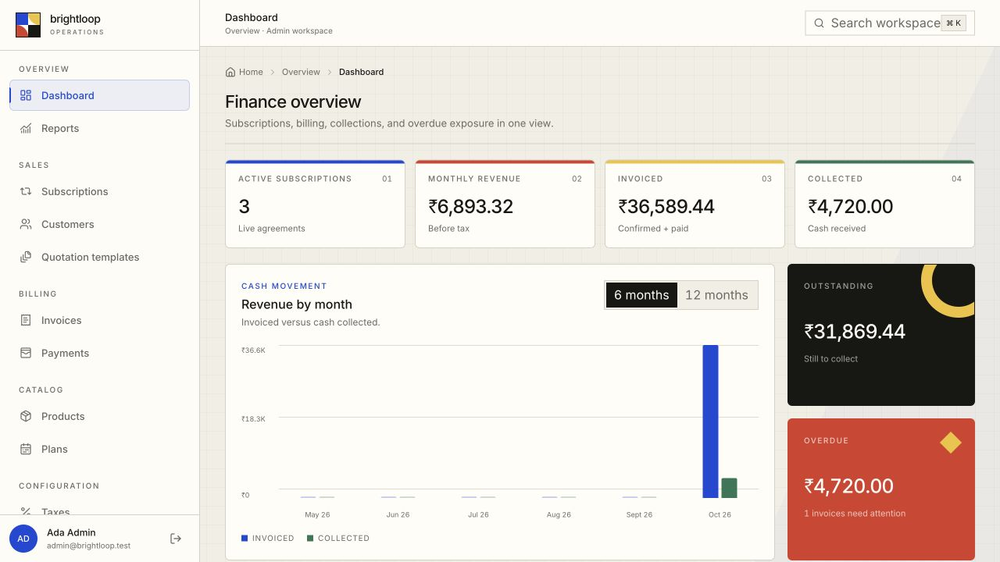

# Brightloop: Subscription Management System

One app that runs a subscription business from end to end: **products and plans → quotes → subscriptions → billing day → invoices → payments → revenue reports**, with a separate portal where customers manage their own subscriptions and pay online.



**Stack:** FastAPI · SQLAlchemy 2 · Alembic · PostgreSQL (Python 3.13) · React 19 · TypeScript · Vite · Tailwind 4 · TanStack Query

**Jump to:** [Run it](#1-run-it-in-five-minutes) · [Logins](#2-logins) · [Highlights](#3-highlights) · [Brief → feature map](#4-every-requirement-in-the-brief-and-where-to-see-it) · [Who can do what](#5-who-can-do-what) · [10-minute walkthrough](#6-a-10-minute-walkthrough) · [Proof](#7-proof-tests-speed-and-correctness) · [Limits](#8-honest-limits)

---

## 1. Run it in five minutes

You need [uv](https://docs.astral.sh/uv/) (it installs Python 3.13 for you), Node 22+ and a local PostgreSQL.

```bash
# Terminal 1: backend on http://localhost:8000 (API docs at /docs)
cd backend
cp .env.example .env                 # set DATABASE_URL to your Postgres user
createdb brightloop_dev
uv sync
uv run alembic upgrade head
uv run python -m app.seed            # demo data: wipes the database first
uv run uvicorn app.main:app --reload
```

```bash
# Terminal 2: frontend on http://localhost:5173
cd frontend
npm install
npm run dev
```

Open **http://localhost:5173** and sign in with a login below. Emails (password reset links, staff invites, invoices) are **printed in Terminal 1**, so you can follow every email without a mail server.

> To start over at any time, run `uv run python -m app.seed` again.

## 2. Logins

| Role | Email | Password | Lands on | What it is for |
|------|-------|----------|----------|----------------|
| **Admin** | `admin@brightloop.test` | `Admin@12345` | Finance dashboard | Sets up products, plans, taxes, discounts and staff; sees everything |
| **Staff** | `staff@brightloop.test` | `Staff@12345` | Today's work queue | Customers, quotes, subscriptions, billing, payments; no setup screens |
| **Customer** | `priya@acme.test` | `Customer@123` | Customer portal | Acme Retail's own subscriptions and invoices only |

You can also **create your own customer account** at `/signup`, which gives you an empty portal.

**Test payments** (customer portal → *My invoices* → *Pay*). This is a built-in test gateway, so no real money moves:

| Method | Approves | Declines |
|--------|----------|----------|
| Card (any future expiry, any CVV, OTP `123456`) | `4111 1111 1111 1111`, `5555 5555 5555 4444` | `4000 0000 0000 0002` (declined by the bank), `4000 0000 0000 9995` (insufficient funds), any wrong OTP |
| UPI | `success@demo` | `failure@demo` |
| Netbanking | pick a bank, then *Simulate success* | *Simulate failure* |

**What the seed creates:**
- **Customers:** three. Acme Retail has a portal login; Northwind Traders and Globex Corporation don't.
- **Catalog:** two GST taxes (18% and 5%). Brightloop CRM comes in two variants, Standard and Odoo (+₹560); Analytics and Priority support are add-ons.
- **Plans:** Monthly (can be paused, closed and renewed), Yearly contract (at least 5 seats, closes by itself) and Weekly trial (closes by itself).
- **Sales:** one quotation template, and a 10% volume discount for 10+ seats.
- **Subscriptions:** five, one in each early stage of the life cycle.
- **Invoices:** three after a billing run. One is **overdue**, one is **paid** and one has the **discount applied**.

## 3. Highlights

The features we're proudest of, and the ones that go beyond the brief:

- **A billing run that never bills twice.** Run it as often as you like: a missed day is caught up and nothing is duplicated. Every run shows `due = created + already billed + skipped + failed`, and the dashboard checks "0 subscriptions billed twice" on every load.
- **Prices worked out on the server.** Variants, add-ons, taxes and discounts are all priced on the server, with `Decimal` money throughout. The screens never do the arithmetic themselves, so a quote, its invoice and its PDF always agree to the paisa.
- **Discounts that apply themselves.** An eligible discount appears on the next invoice with no one to remember it, and stops once it expires or its usage limit runs out. A cancelled invoice doesn't use up a use.
- **Online payment like a real Indian gateway.** Card with OTP, UPI and netbanking. The order is created on the server, the result is signed and checked by the server, and a webhook-style notification is sent. Swapping in Razorpay means replacing one service, not the screens.
- **Bank reconciliation.** Upload a bank statement CSV and each credit is matched to an open invoice, with the reason shown ("invoice number matches", "part payment"). You approve the matches and they're recorded once. Upload the same file again and nothing is paid twice. Try it with the built-in **sample statement**.
- **Customer self-service portal.** Customers see what they owe, pay online, download their PDFs, and pause, resume, cancel, renew or switch add-ons, but only where their plan allows it.
- **A finance view in one place.** Active subscriptions, monthly recurring revenue (net of discounts), invoiced, collected, outstanding, overdue, a revenue-by-month chart and the ageing of unpaid invoices. It has filters, refreshes every 30 seconds, and explains how each number is calculated.
- **Proper invoices.** The PDF carries the company letterhead and a PAID, DRAFT or CANCELLED stamp. There's a print page, and email with the PDF attached. **Overdue reminders** are sent at most once per stage.
- **Everyday tools.** Customer 360 page (numbers, subscriptions, invoices, payments, activity), workspace search (`⌘K`), CSV export on every list, a full history of who changed each subscription, and a layout that works on phone, tablet and desktop.
- **Access control enforced on the server.** Every API route checks the role, and customers can only ever reach their own records: another customer's invoice returns "not found".

## 4. Every requirement in the brief, and where to see it

The brief tells the story of one billing month at Brightloop. Each scene is listed here with how we met it.

### A new customer signs up
| Requirement | How it's met | See it |
|---|---|---|
| Sign up with email and password | Self sign-up creates a customer account and portal | `/signup` |
| One account per email | Emails are unique whatever their case (`A@x.com` = `a@x.com`) | Sign up twice with the same email |
| Password: more than 8 characters, upper, lower, special | Each rule is shown live on the field and checked again on the server | `/signup`, `/users` |
| Reset link to the registered email | One-hour, single-use link. The same neutral reply whether or not the email exists | `/forgot-password` (link prints in Terminal 1) |
| Admin / staff / customer see different things | Three workspaces, enforced on every API route | [Who can do what](#5-who-can-do-what) |
| Only the admin adds staff | Admin-only **Users** page. A new staff member must choose their own password on first sign-in; the admin can switch anyone's access off | Admin → `/users` |

### Launching a new plan
| Requirement | How it's met | See it |
|---|---|---|
| Product with name, type, sales price, cost price, notes | Full product form, plus default taxes and an add-on flag | Admin → `/products` |
| Variants, e.g. Odoo brand adds 560 | Attribute / value / extra price; Brightloop CRM → Brand: Odoo **+₹560** is seeded | `/products` → Brightloop CRM |
| Plan price and billing period (daily, weekly, monthly, yearly) | All four periods; month-end dates handled (31 Jan + 1 month = 28/29 Feb) | Admin → `/plans` |
| Minimum quantity and availability dates | Enforced when a subscription is saved; a plan can't end before it starts | `/plans` → Yearly contract (min 5) |
| Closes by itself / can close early, pause, renew | Four switches per plan; the buttons appear only where the plan allows them | `/plans`, then any subscription |

### Turning a quote into a subscription
| Requirement | How it's met | See it |
|---|---|---|
| Quotation template with plan, lines and validity days | Templates with lines; **Use template** creates a draft in one step | `/quotation-templates` → Enterprise yearly (Odoo) |
| Subscription number, customer, plan, start, expiry, payment terms | `SUB-00001` numbering that can't collide | `/subscriptions/new` |
| Lines with product, quantity, unit price, taxes, amount | Priced live by the server as you type | `/subscriptions/new` |
| Draft → Quotation → Confirmed → Active → Closed | Enforced on the server; the screen offers only legal next steps, shows a progress bar and records who did what | Any subscription |

### Billing day
| Requirement | How it's met | See it |
|---|---|---|
| Hundreds due at once, no typing | **Billing run** creates a draft invoice for every due period, with customer, lines, taxes and totals filled in. It also runs by itself every day at 02:00 | `/billing-run` |
| Taxes from the admin's rules | Percentage or fixed-amount taxes per product, applied after any discount | `/taxes`, then any invoice |
| Confirm, cancel, send, print | All four, plus a PDF download. `INV-2026-00001` numbers are given at confirm | `/invoices` → open one |
| Draft → Confirmed → Paid | Paid is set automatically once payments cover the total | `/invoices` |
| Nothing billed twice or skipped | Unique per subscription and period in the database; missed periods are caught up; a cancelled period is re-billed only by an admin | Run billing twice; Dashboard → *Billing integrity* |

### A customer asks for a better price
| Requirement | How it's met | See it |
|---|---|---|
| Only the admin creates discount rules | Admin-only page and API | Admin → `/discounts` |
| Fixed or percentage, minimum purchase or quantity, start and end, usage limit | Every rule is supported, and the limit shows as "2 of 5 used" | `/discounts` |
| Specific products or whole subscriptions | Both scopes | `/discounts` → New |
| Appears on the next invoice by itself, and stops when it expires or runs out | Applied by the billing run; the Globex invoice shows the seeded 10% | `/invoices` → Globex invoice |

### The money comes in
| Requirement | How it's met | See it |
|---|---|---|
| Record method, amount, date, note against an invoice | Part payments allowed, overpayment refused, the invoice turns Paid by itself | Any confirmed invoice → *Record payment* |
| See paid vs outstanding, chase overdue | Status and outstanding columns, an "Overdue only" filter, ageing buckets, one-click reminders | `/invoices`, `/payments`, Staff dashboard |
| *(beyond the brief)* | Online payments from the customer portal and bank-statement reconciliation | `/portal/invoices`, `/reconciliation` |

### The finance lead, at the end of the month
| Requirement | How it's met | See it |
|---|---|---|
| Active subscriptions, revenue, payments, overdue invoices | All in one dashboard, plus outstanding, ageing and revenue by month | Admin → `/dashboard` |
| Filters and a summary view | Date range, plan, customer and status filters; summary cards and charts | `/reports` |
| Thousands of subscriptions, every page under 2 seconds | Server-side paging and aggregate queries. Measured at **under 0.3 s per API call** with 5,000 subscriptions (warm cache, on a laptop) ([numbers below](#7-proof-tests-speed-and-correctness)) | `uv run python -m app.seed --big` |

## 5. Who can do what

| | Admin | Staff | Customer |
|---|:-:|:-:|:-:|
| Dashboard and reports | Finance view | Today's work queue + reports | Own home page |
| Products, plans | Create / edit | View only | – |
| Taxes, discounts, users | ✅ | – | – |
| Customers, quotation templates, subscriptions | ✅ | ✅ | Own subscriptions |
| Pause / resume / close / renew / add-ons | ✅ | ✅ | Own, where the plan allows |
| Billing run, confirm / send / print invoices | ✅ | ✅ | Own invoices: PDF and print |
| Cancel an unpaid invoice | ✅ | ✅ | – |
| Re-bill a cancelled period, run the lifecycle job | ✅ | – | – |
| Record payments, bank reconciliation | ✅ | ✅ | Pays online |

Every row is enforced by the API, not just hidden in the menu. Opening a page you can't use shows a 403 page.

## 6. A 10-minute walkthrough

Everything below works on a freshly seeded database, in this order.

| # | Sign in as | Do this | You should see |
|---|---|---|---|
| 1 | *(signed out)* | `/signup`: try a weak password, then a valid one. Sign up again with the same email in capitals. Then use **Forgot password** | The missing rule is named on the field; the duplicate email is refused; the reset link prints in Terminal 1 |
| 2 | Admin | **Users** → *Add staff member* | Only the admin can do this; the invite message shows the first password, which must be changed at first sign-in |
| 3 | Admin | Look through **Products**, **Plans**, **Taxes** and **Discounts** | The Odoo +₹560 variant; plans with different close, pause and renew rules; tax and discount rules |
| 4 | Staff | **Quotation templates** → *Use template* for Northwind → *Send quotation* → *Confirm* → *Activate* | Lines, prices and taxes filled in by the server; the history shows each step and who took it |
| 5 | Staff | **Billing run**, then *Run again* | The new subscription is invoiced once; the second run creates nothing; the counts add up |
| 6 | Staff | **Invoices** → open the new draft → *Confirm* → *Record payment*: a part payment first, then the rest; then *Send* and *Download PDF* | A number is given at confirm; the 10% volume discount was applied by itself (10 seats); Paid with a PAID stamp; overpaying is refused |
| 7 | Customer | **My invoices** → open the overdue invoice → *Pay* with `4000 0000 0000 0002`, then with `4111 1111 1111 1111` and OTP `123456`. Then open a monthly subscription and **Pause** / **Resume** it | The decline is explained and nothing is charged; then the invoice is Paid and Home turns "all paid up"; only the buttons the plan allows are shown |
| 8 | Admin | **Dashboard**, then **Reports** with a filter | Active subscriptions, revenue, collected, outstanding, overdue and ageing, all agreeing with each other |
| 9 | Staff | **Bank reconciliation** → *Sample statement* → *Record payments*. Upload it again | Credits matched to invoices with the reason shown; the second upload says every line was recorded before |

The full click-through checklist, with every edge case, is in [docs/TEST_CHECKLIST.md](docs/TEST_CHECKLIST.md).

## 7. Proof: tests, speed and correctness

- **203 backend tests** (`cd backend && uv run pytest`) cover:
  - password rules, roles and the customer data wall;
  - pricing, discounts and taxes;
  - the subscription state machine;
  - billing idempotency and catch-up;
  - payments, overpayment and reconciliation;
  - the payment gateway's signatures;
  - PDFs, email and the print page.
- **Never billed twice:** a unique index on (subscription, period start) for every invoice that isn't cancelled, row locks on payments, and a live check on the admin dashboard.
- **Speed with 5,000 subscriptions** (`uv run python -m app.seed --big`: 5,000 subscriptions, 11,582 invoices, 9,266 payments). These are the slowest API calls behind each page, measured on a laptop:

| Page | Slowest API call |
|---|---|
| Admin dashboard (summary, chart, overdue, ageing, proof, work queue) | 286 ms |
| Reports with filters | 274 ms |
| Customer page | 50 ms |
| Subscriptions, Invoices, Payments, Customers (with filters) | 13 ms or less |
| Billing run: **5,134 invoices due at once** | 31.5 s; running it again: 0 created, instant |

## 8. Honest limits

- Emails print in the backend terminal unless `SMTP_HOST` is set in `backend/.env`.
- The payment gateway is a built-in test-mode simulator, not a live provider.
- The billing run handles everything due in one request: fine for hundreds at once. On the big data set, 5,134 invoices due at once took 31.5 seconds.

---

<details>
<summary><b>For developers: commands, layout and conventions</b></summary>

### Everyday commands

| Where | Command | What it does |
|-------|---------|--------------|
| backend | `uv run pytest` | Tests (needs a `brightloop_test` database: `createdb brightloop_test`) |
| backend | `uv run ruff check . && uv run ruff format .` | Lint and format |
| backend | `uv run alembic revision --autogenerate -m "what changed"` | New migration after editing `app/models` |
| backend | `uv run alembic upgrade head` | Apply migrations |
| backend | `uv run python -m app.seed` | Reset demo data, invoices and payments |
| backend | `uv run python -m app.seed --big` | Seed 5,000 subscriptions for performance checks |
| frontend | `npm run build` | Type check and production build |
| frontend | `npm run lint` | oxlint |

**Daily jobs.** The server bills everything due and then runs the lifecycle job (auto-close, quote expiry) every day at 02:00 server time. For a demo, use **Billing run** and the lifecycle button in the app instead. Set `SCHEDULER_RUN_ON_START=true` to also catch up shortly after start-up, or `SCHEDULER_ENABLED=false` to turn the scheduler off.

### Where things live

```
backend/app/models/          data model
backend/app/core/            password policy, session cookie, current user and role guards
backend/app/routers/         APIs for identity, selling, billing, reports and both portals
backend/app/services/        pricing, subscriptions, billing, discounts, invoices, gateway, reconciliation
backend/app/services/sequence.py   atomic SUB-/INV- numbering
backend/app/seed.py          demo data (add --big for 5,000 subscriptions)
frontend/src/nav.ts          sidebar menu and which roles see each page
frontend/src/routes.tsx      routes; pages register themselves from src/pages/<route>/index.tsx
frontend/src/auth/           session state and the role route guard
frontend/src/lib/api.ts      fetch wrapper (cookies, errors)
```

More detail: [PLAN.md](PLAN.md) (build plan), [docs/PRD.md](docs/PRD.md) (requirements), [docs/API_CONTRACT.md](docs/API_CONTRACT.md) (API).

### Conventions

- **Authorize on the server, on every route** with `Depends(require_roles(...))` or the `AdminUser` / `StaffUser` / `CustomerUser` aliases from `app.core.deps`. The frontend guard only decides what to render.
- **Customers see only their own records:** scope portal queries by `user.customer.id`.
- **Money is `Decimal`** in Python and `Numeric(12,2)` in the database, and travels as a string in JSON. All arithmetic goes through `app/services/pricing.py`; the frontend calls `POST /api/pricing/preview` and formats with `money()`.
- **Numbers:** use `next_number()`, never `count() + 1`.
- **Email format is checked on sign-up, not sign-in:** `EmailStr` rejects reserved domains like `.test`, which the demo users use.
- Branch per feature, small PRs, rebase on `main` often, one migration per PR.

</details>
